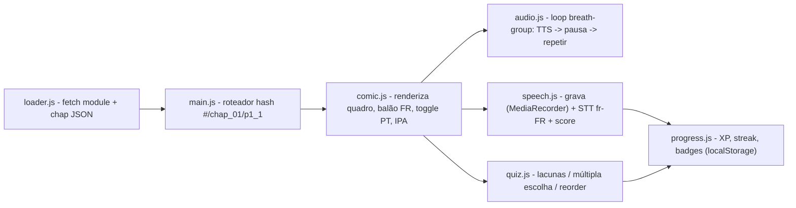

# Arquitetura — HQ Gamificada de Francês (Pedro Hagah)

## 1. Princípios (por que é a opção mais econômica)
| Decisão | Motivo |
|---|---|
| **Data-driven**: todo conteúdo pedagógico em JSON, engine única | Novas partes/capítulos não exigem código → IA só gera JSON (barato, validável) |
| **Vanilla JS, zero build, zero deps** | Menos arquivos/contexto para a IA ler; nada para quebrar; roda em qualquer servidor estático |
| **Web Speech API** (`speechSynthesis` fr-FR + `SpeechRecognition` fr-FR) | TTS e avaliação de pronúncia grátis, offline-ish, sem chaves |
| **MediaRecorder** para gravação do aluno | Nativo do navegador, salva em memória/IndexedDB |
| **localStorage** para progresso/XP | Sem backend nesta fase |
| **Validador Node sem deps** (`tools/validate.mjs`) | Pega erros de JSON antes de abrir o app → menos ciclos de depuração |
| Áudio pré-gerado **opcional** (Piper fr_FR local, Fase 5) | Voz melhor sem custo de API; fallback sempre é Web Speech |

## 2. Estrutura de pastas
```
d:\Projetos\Idiomas
├─ AGENTS.md                      # regras p/ agentes (ler primeiro)
├─ docs/
│  ├─ HANDOFF.md                  # STATUS + checklist (fonte da verdade do progresso)
│  ├─ ARQUITETURA.md              # este arquivo
│  └─ ERRATA.md                   # correções aplicadas ao manual original
├─ content/fr/partie_01/
│  ├─ _source/manual_original.md  # texto original do usuário (imutável)
│  ├─ module.json                 # manifesto da Parte 1 (métricas, vocabulário, lista de capítulos)
│  ├─ chap_01.json                # ✅ MODELO-OURO
│  ├─ chap_02.json … chap_04.json # a converter
├─ tools/
│  └─ validate.mjs                # valida module.json + capítulos
├─ app/                           # (Fase 2) engine web
│  ├─ index.html
│  ├─ styles.css
│  ├─ js/ main.js | loader.js | comic.js | audio.js | speech.js | quiz.js | progress.js
│  └─ content -> servido de ../content (ver nota abaixo)
└─ assets/ img/ audio/            # (Fase 5) ilustrações e mp3 opcionais
```
> Nota: para o servidor estático enxergar `content/`, servir a **raiz do projeto** e abrir `/app/`. O loader usa caminho `../content/fr/partie_01/`.

## 3. Schema de dados

### 3.1 `module.json`
```json
{
  "module_name": "Partie_1_Pedagogie_Immersive",
  "author": "...", "target_language": "fr-FR", "native_language": "pt-BR",
  "evaluation_metrics": { "pronunciation_accuracy_threshold": 0.85, "speech_rate_wpm_target": 110, "pause_tolerance_seconds": 2.0 },
  "chapters": [ { "id": "chap_01", "file": "chap_01.json", "status": "done|todo" } ],
  "vocabulary_mastery_list": ["..."]
}
```

### 3.2 Capítulo (`chap_XX.json`) — campos obrigatórios marcados com *
```jsonc
{
  "chapter_id": "chap_01",*        "order": 1,*
  "title_fr": "...",*              "title_pt": "...",*
  "context": { "summary_pt": "...", "bullets_fr": ["..."] },
  "scenes": [ {
    "scene_id": "s1",* "title_fr": "...",*
    "panels": [ {
      "panel_id": "p1_1",*
      "visual_description": "...",*          // vira prompt de imagem na Fase 5
      "image": null,                          // caminho em assets/img quando existir
      "voice_direction": "...",               // tom/ritmo
      "dialogue_fr": "...",*  "dialogue_pt": "...",*
      "breath_groups": [ { "fr": "...", "pause_ms": 2500 } ],*  // loop ouvir→repetir
      "audio_target_duration_ms": 4500,*
      "pause_repetition_ms": 5500,*          // silêncio após a frase inteira
      "phonetics_guide": "[IPA]",*
      "pronunciation_tip_pt": "...",
      "interactive_quiz": {*
        "type": "fill_in_the_blank | multiple_choice | reorder",
        "sentence_masked": "... _____ ...", "correct_answer": "...",
        "distractors": ["...","...","..."], "explanation_pt": "..."
      }
    } ]
  } ],
  "grammar": [ { "id": "g1", "title_fr": "...", "title_pt": "...", "explanation_pt": "...",
                 "formula": "opcional", "table": { "headers": [], "rows": [[]] } } ],
  "exercises": [ { "id": "ex_a", "type": "fill_in_the_blank | multiple_choice | audio_recording",
                   "instruction_fr": "...", "instruction_pt": "...",
                   "items": [ { "prompt": "...", "options": ["opcional"], "answer": "..." } ],
                   "script_fr": "só p/ audio_recording" } ],
  "vocabulary": [ { "fr": "...", "pt": "...", "ipa": "..." } ]
}
```
Regras: `panel_id` único no capítulo; `correct_answer` ∉ `distractors`; `sentence_masked` contém `_____`; para `fill_in_the_blank` a frase com a resposta deve ser igual a `dialogue_fr` (validador checa).

## 4. Engine (Fase 2) — módulos JS

- **Loop de treino oral** (`audio.js`): para cada `breath_group`: falar (`speechSynthesis`, `lang=fr-FR`, `rate≈0.9`) → silêncio `pause_ms` (barra de progresso visual "Sua vez!") → ao fim, frase inteira → silêncio `pause_repetition_ms`. Botões: ▶ ouvir, 🐢 lento (rate 0.7), 🔁 loop.
- **Score de pronúncia** (`speech.js`): `SpeechRecognition` fr-FR → normalizar (minúsculas, sem pontuação; manter acentos) → similaridade = 1 − Levenshtein(palavras)/max(len). Passa se ≥ `pronunciation_accuracy_threshold` (0.85). Fallback sem STT (Firefox): autoavaliação 👍/👎 + reprodução da gravação.
- **Gamificação** (`progress.js`): +10 XP quadro ouvido, +20 repetição aprovada, +15 quiz correto, +50 capítulo completo; streak diário; badges por capítulo. Chave `localStorage`: `hq_fr_progress_v1`.
- **UI**: layout de HQ (grid de quadros), balão com texto FR, toque no balão = mostra PT; ícone "IPA" mostra fonética + dica. Mobile-first.

## 5. Fases
Ver checklist detalhado em `docs/HANDOFF.md`.
1. Arquitetura + modelo-ouro + validador ✅
2. Conversão chap_02..04 para JSON (tarefa ideal p/ modelo barato)
3. Engine web mínima (leitura + áudio + quiz)
4. Gravação/STT + gamificação
5. Ilustrações (image-generator, a partir de `visual_description`) + áudio Piper fr_FR opcional
6. Partes 2+ do manual: apenas novos JSON
